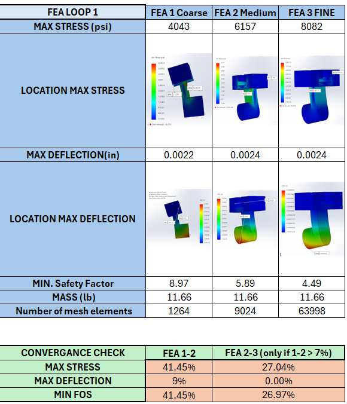
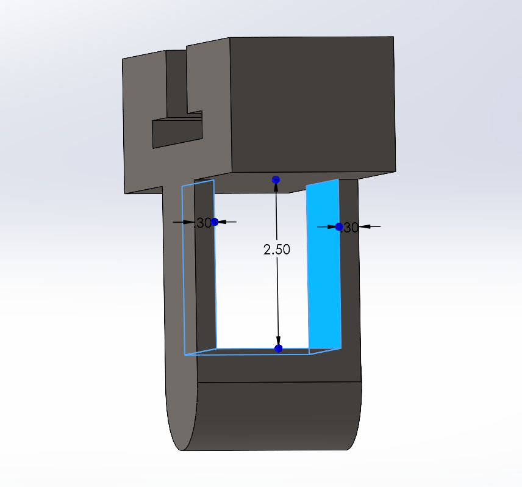
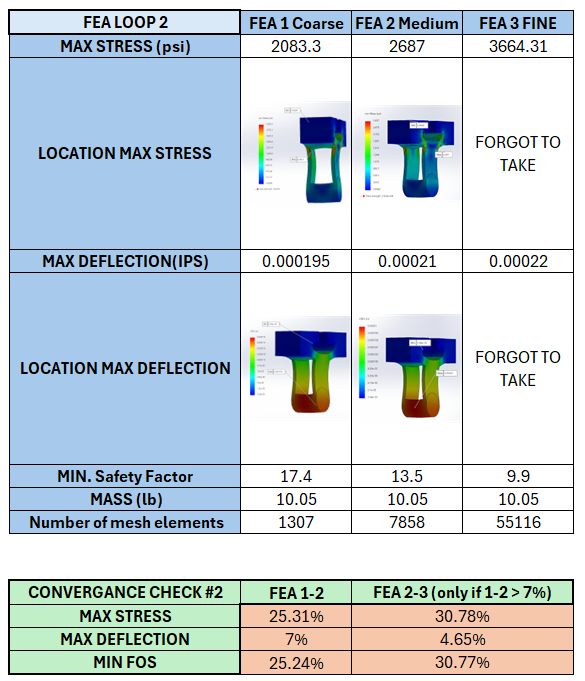
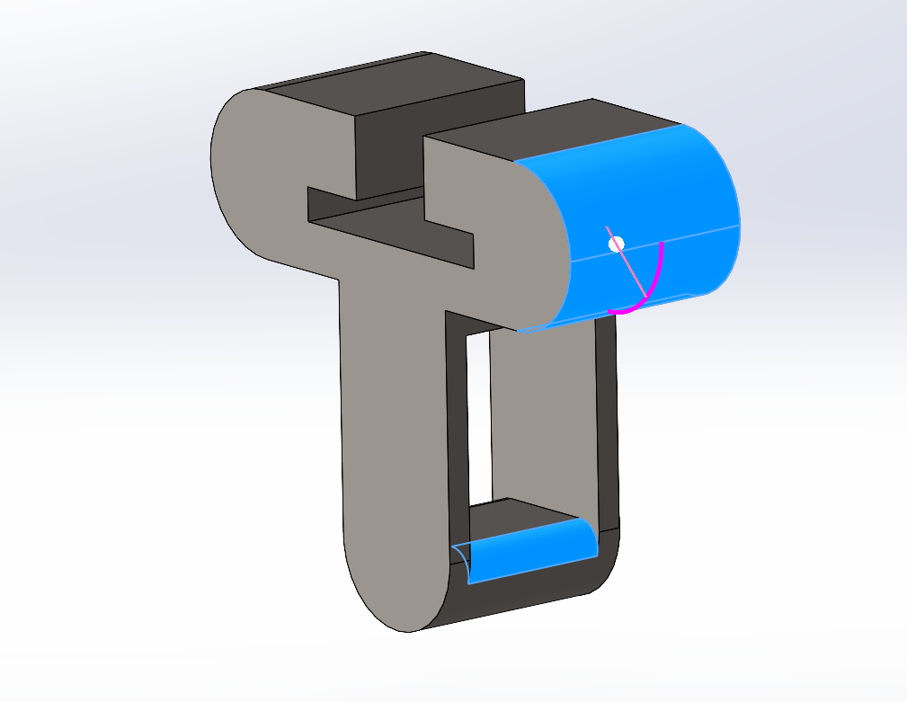
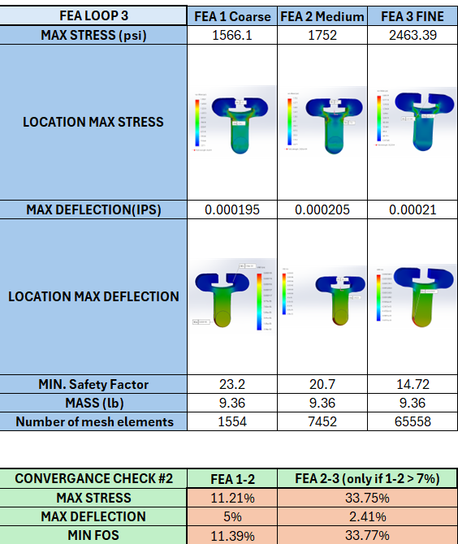

# A7 – [FEA of Bracket (CONT. from A5 and A6)]

## Objective

This week's assignment is a continuation of A5 and A6, where we were tasked with creating a bracket in which would be axially loaded. This assignment set out to teach us how to use Finite Element Analysis (FEA) in order to optimize the design given certain parameters. We were asked to show our results for the following charts: Stress, Displacement, and the Safety Factor. All three of the charts had to converge to a 7% difference, thus afterword we were to adjust/make geometric modifications.

Material used for this part is ASTM A36 Steel, this will stay consistent throughout the entire process.

## FEA LOOP #1
The first step in running the first inner loop, was to create a static study for my [OG part](Part1.SLDPRT). Setting the fixed structure geometry, the loading, finally setting the mesh size. Once all of the initial parameters were set then we can run the study, which finally gave me the following values.

  I ran the studies for coarse and medium meshes, then I used an error estimation equation within an Excel sheet, and as seen above the following errors were outputted. My values were clearly not below a 7% threshold, that we were told to try and achieve, so I had to run another simulation this time with Fine mesh. Again I ran another error estimation and came up with the values being greater than 7%. I came to the conclusion that my equations all the way from A5 were inputted wrong and it came back to bit me in the ass.

  Once I've ran everything, I was then able to finally make a geometric design change/modification.

  ## FEA LOOP #2

  The second loop consisted of me beefing up the structure, mostly in areas I deemed the most affected by deflection. The [second version](MESHSTUDIESCUTVERSION.SLDPRT) of my part, aimed to create more stability, reduce the deflection and reduce weight of the overall part. I achieved this by adding a second vertical support and elongating the hanger/bracket a tad bit so that the shaft that stuck out a bit was now somewhat in the line of sight for the part to now connect easily. 

  

  

  Again my values are all sorts of wacky, therefore running another fine mesh and still not being able to converge to less than 7%.
  Some other notable changes that were prevalent were the stress for each inner loop in this second iteration oddly increased, along with deflection, however the minimum safety factor did quite the opposite. 

  ## FEA LOOP #3

  For the third and final iteration, I chose to round out the edges (chamfering and filleting) wherever it seemed that stress was going to cross through, at an attempt to reduce it. As seen in the image below.

  

   

  After running the simulation, it seemed that the use of rounded edges, indeed helped in reducing the amount of stress the part distributed throughout itself. The stress was significantly lower, along with the error estimation being significantly smaller. Overall I think that had I not used the incorrect numbers from the beginning of A5 the finished result would've been so much better and it would've adhered to the <7% error estimation.

  [Final Bracket version](MESHSTUDIESROUNDVERSION.SLDPRT)

  

## Lessons Learned

With this assignment I learned how different mesh sizes affect the results of an FEA analysis. Usually the finer the mesh, the more mesh elements that a part has, the more accurate the results, and the longer it takes for it to evaluate results. 

I also learned how to add forces in different directions other than the usual one which doesn't reference itself off a separate part. Overall I think that the FEA portion of this course was very informative, with not only learning how to use FEA, but design with the data given by the simulation. I am almost positive that this will be used greatly in the field I want to go into. 

Bit of a learning curve for certain steps and overall laziness made this assignment take me around 4 hours. Mostly procrastination...

