# A8 – Gears

## Objective

For this assignment I was asked to create a gearbox that can be fully assembled and disassembled. The gearbox should incorporate spur gears to achieve a specified gear ratio, output torque, and rotational speed. Ensure that the input and output shaft dimensions align with standard design practices.

## Assignment 08 - Worked Solutions

[Download Worked Solutions PDF](A8WORK.pdf)

## Assignment 08 - Equations

[Download Equations PDF](A8eqs.pdf)

Above me are the equations used and all parameters solved algebraically and parametrically.

The first thing we had to do for this assignment was to check and see that the diameters of the shafts are sufficient. The first thing to do was list out all of my unknowns and knowns, then I could draw my FBD's, solve the equations, and then see if there sufficient. 

After using the power-transmission and short shaft equations from the machinery's handbook I was able to determine that both shaft diameters were sufficient, so no changes were needed. The next thing on the list was to design the journal bearings.

After choosing an appropriate length of the bearing I had to determine the pressure, velocity, and PV rating. Doing this would allow me to pick a material that would best suit my bearing. In the following images/pages you will be able to see the process. I started things off by writing all of my knowns and unknowns and FBD's.

Somewhere along the way I made a mistake and ended up with an abnormally small thickness for the journal bearings. So when making the bearings I decided to use the ones provided to us in the resource page.

## SolidWorks

I was then tasked with creating an assembly for the gearbox. We were only given the following parts. Gear, Pinion, and the Journal Bearings; as for the rest like the shaft and gear housing, those we had to make ourselves.

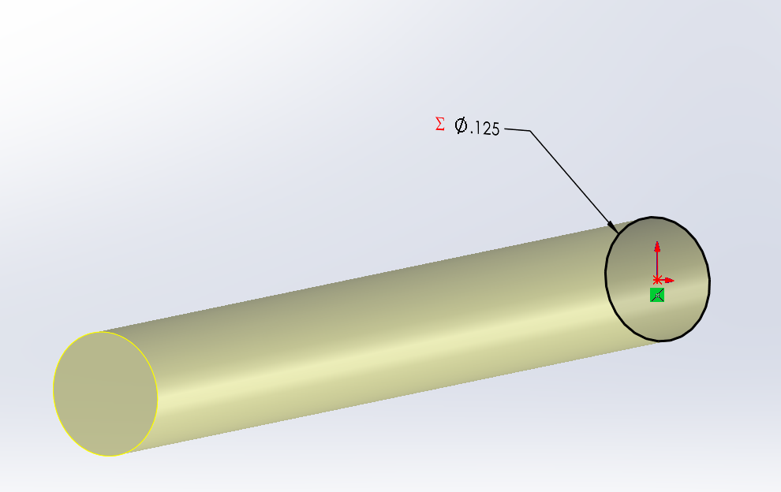
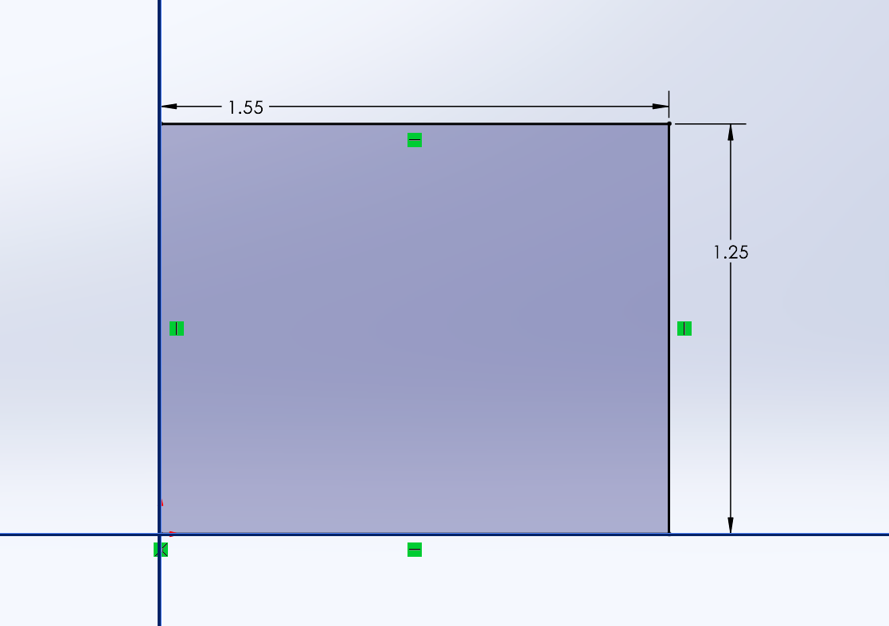
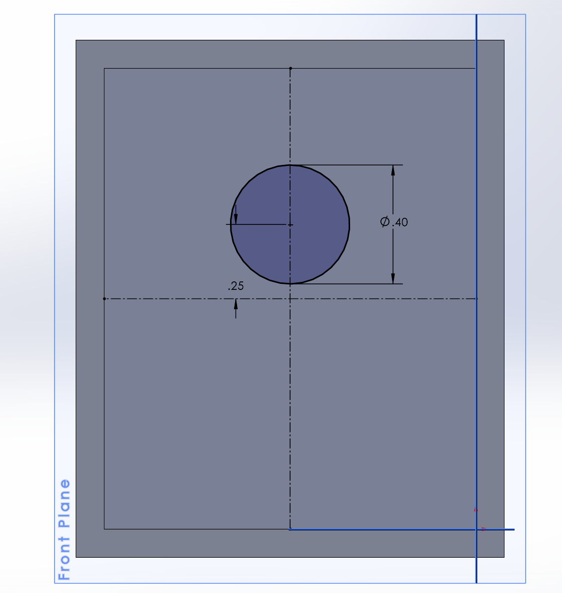
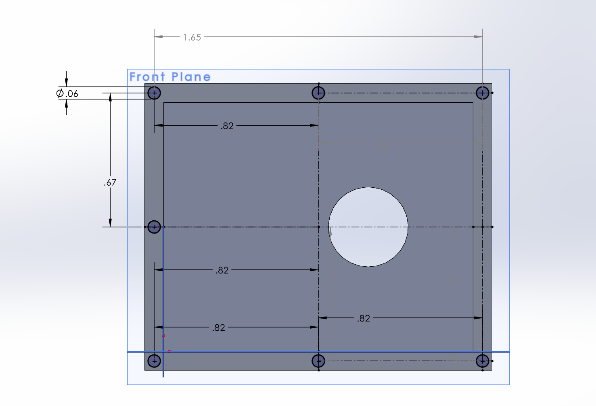
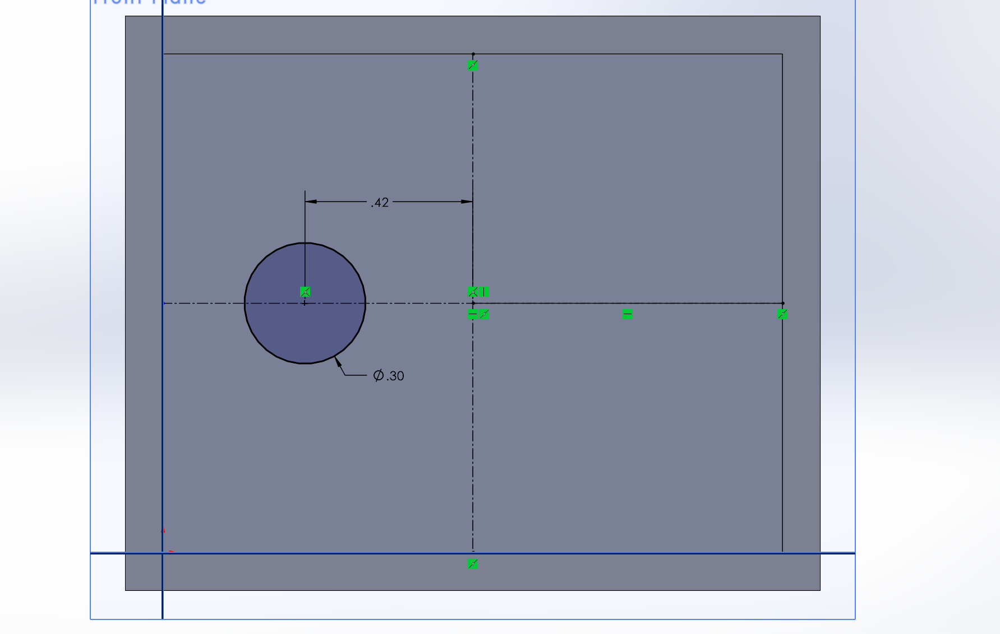
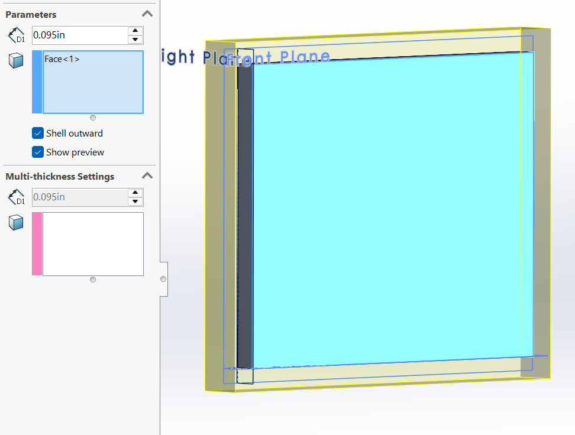
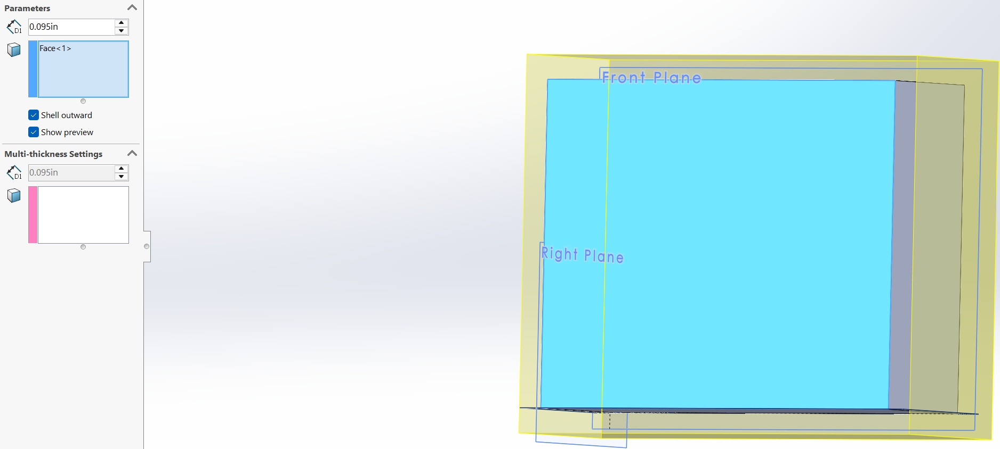
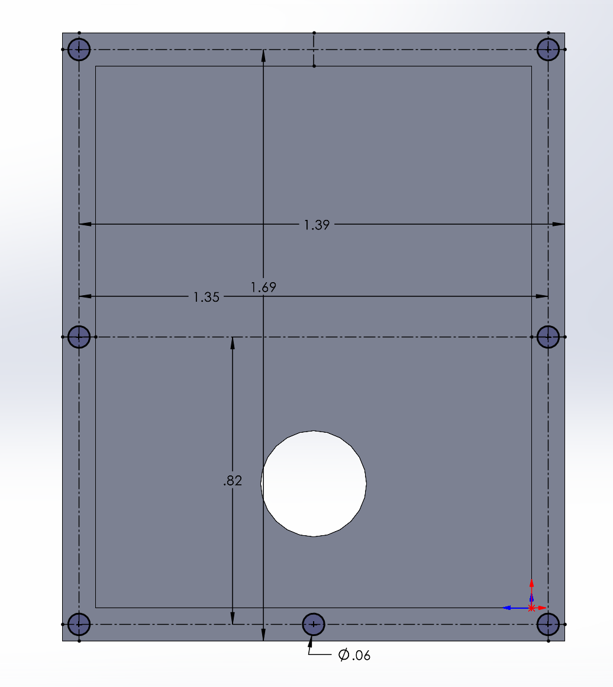
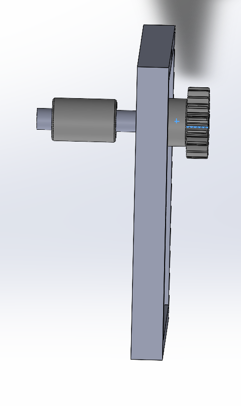
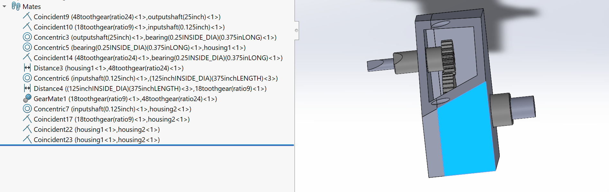
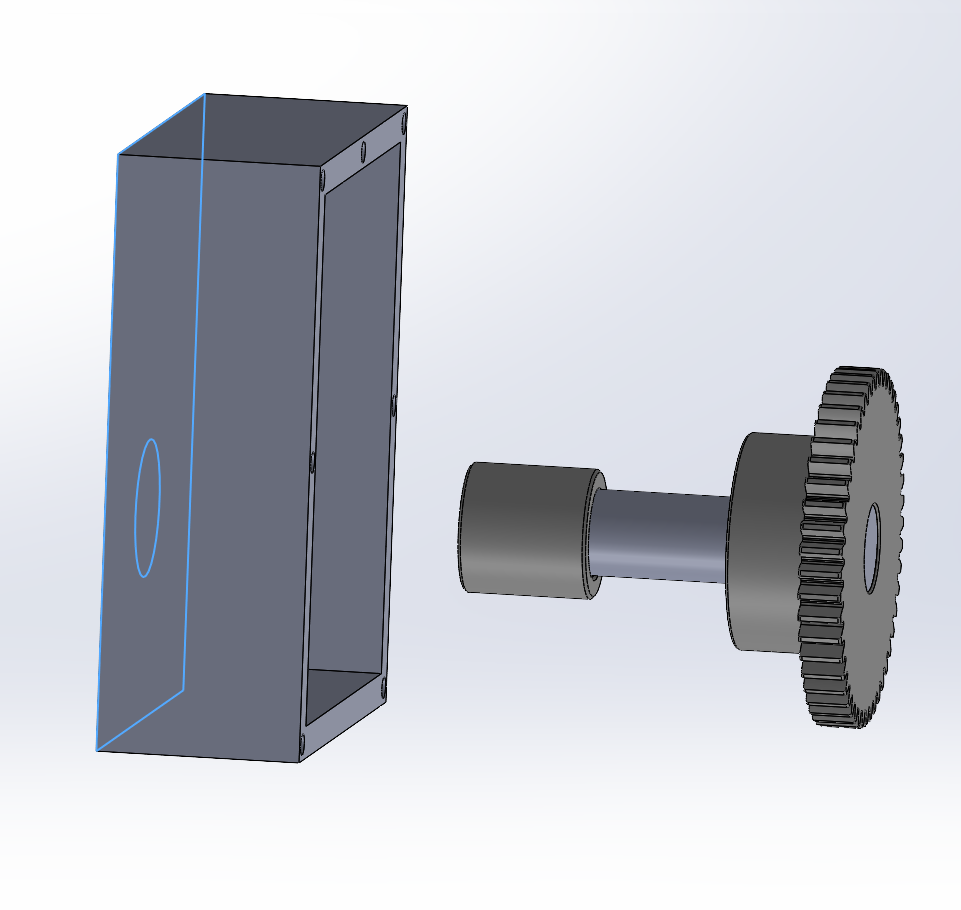

Above is the progression from shaft to shell to screw hole (to secure the housing), to assembly of all the parts together.
One thing to note is that the mating for the gears is incorrect I could not figure out how to mesh them properly so that they could freely spin. It may have to do with he fact that my previous mates impede it from spinning. I also included a sliced view of the inside of my housing so that, others could see the amount of room left inside the housing itself, this extra room is unnecessary and in future iterations should probably be reduced and optimized for weight, size and cost.

## Communicate

This assignment taught me a lot about gears, as my previous experience with gears only included the commonly used gear ratio to find the number of teeth for a gear. This assignment went beyond that and introduced me to new equations that use gear ratio to find out it's limits and tolerances for forces on its shafts and other parts such  as the bearings. Another thing to note is that, it matters which edges and faces are mated with which, because if a certain face is mated in a certain way, it will avoid desired movement as noted when trying to mesh the gear properly and have it move.

This Assignment took me around 10 hours to complete, a lot of back and forth between equations and CAD to figure out discrepancy's mostly because 
I inputted the incorrect values.

