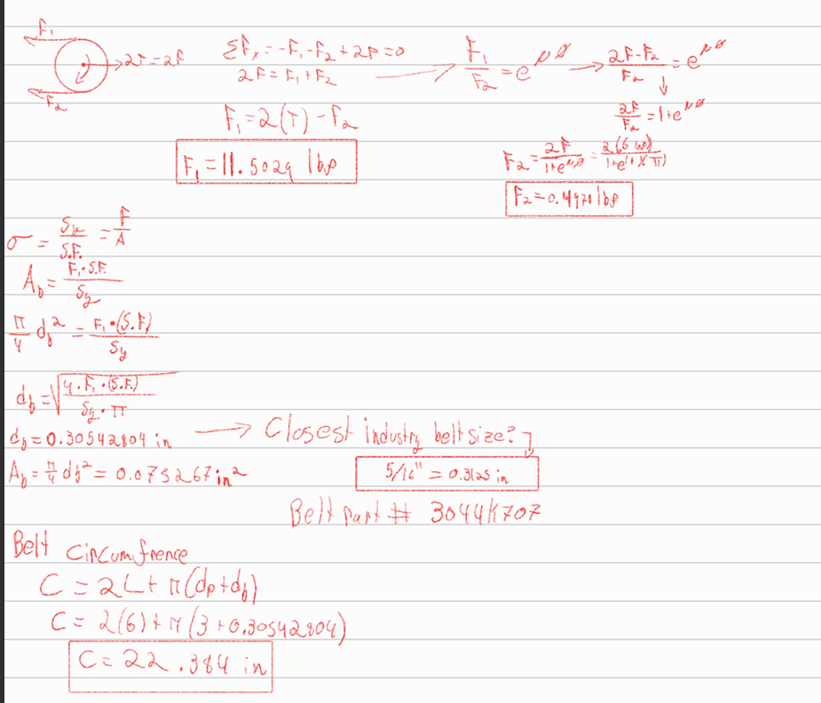
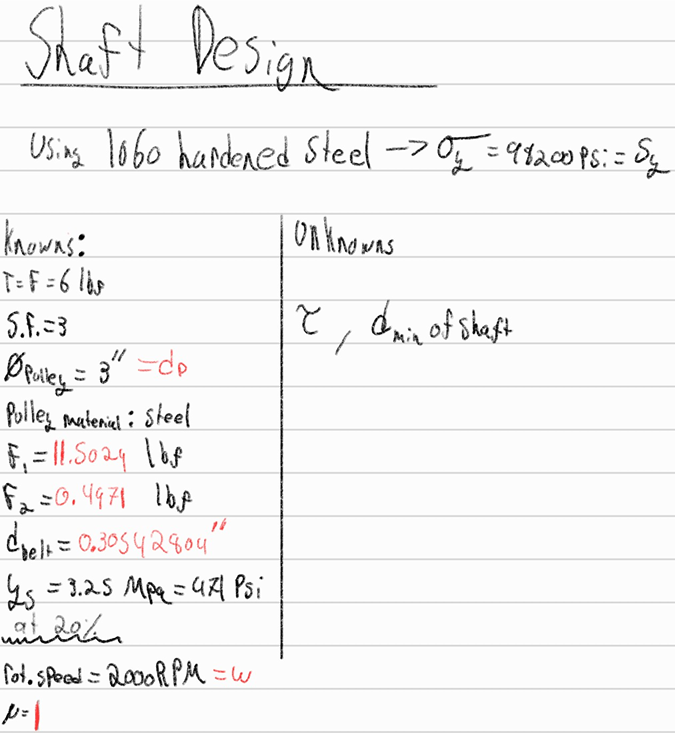
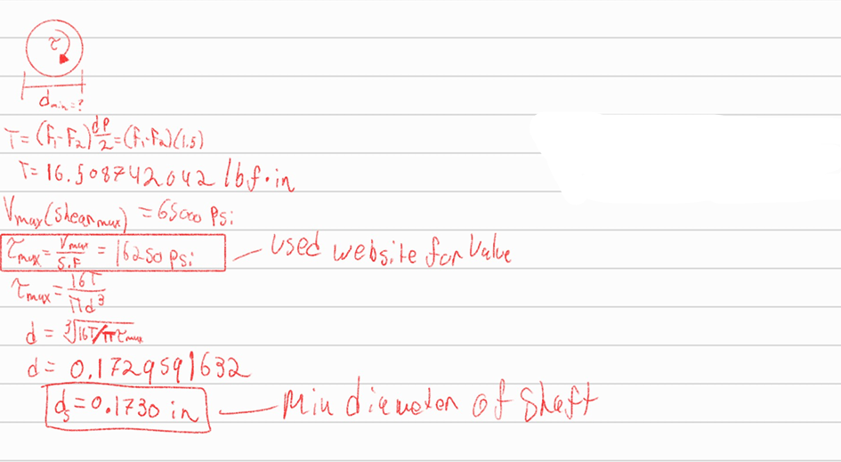
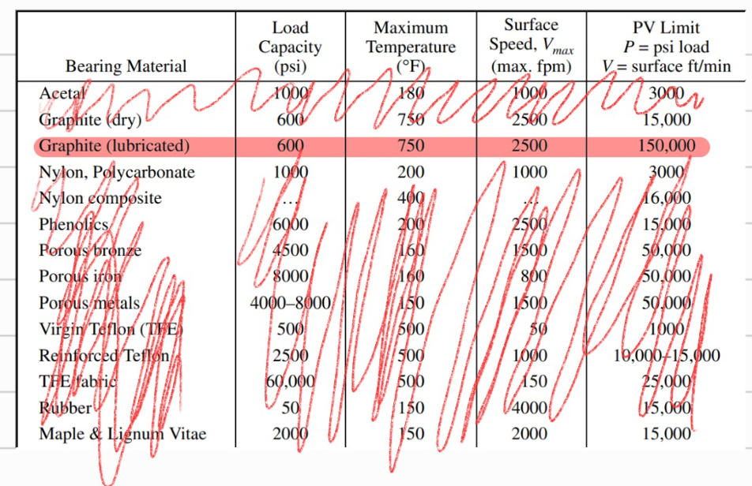

# A9 – Pulleys

## Objective
This weeks assignment had us designing a pulley system that transfers power from one axis to another over a distance of 4-6 inches. We were asked to choose between a tension range of 4-6 lbf, for when the belt is static(stationary). The pulleys given to us were specified to have 3 inches in diameter, additionally we were to choose the rotations they would spin at within the following range of 1000-2000 rev/min (rpm). The pulleys material was also left up to us, with the following materials being Aluminum, ABS, or steel. We were required to keep a safety factor of 3, and use a polyurethane rubber belt, with a yield strength of 3.25 MPa(471 psi) at a strain of 20%.

## Part 1 : Belt Design

We first had to find out the size of the belt we needed for the pulleys. We assume that the situation we are in is perfect such that there is no slippage, meaning friction is 1.

The rough diameter of the belt needed was around 0.305 inches which doesn't exactly have a fraction form, however by comparing preexisting belt sizes i found that a 5/16" belt is 0.3125" which is close enough for this assignment. Using the McMaster Carr [website](https://www.mcmaster.com/products/round-belts/diameter~5-16/outer-circumference~24-1-4/) i found one that closely matched the circumference aswell.

## Part 2: Shaft Design

For this design I needed to find the minimum diameter of the shaft that would have torque applied to it. The shaft material had to be made from 10260 hardened steel when the torque is applied.

This is the link I used for the shaft design [shear max value](https://www.makeitfrom.com/material-properties/SAE-AISI-1060-S58C-G10600-Carbon-Steel) (which is wrongly circled as the torque max value)...

I got the shaft diameter to be around 0.1730 inches.

## Part 3: Journal Bearing

With my belt and shafts taken care of, the next line of action was to take care of my journal bearings. We were told that these bearings were to be made of sintered metal or non-metallic material. However, I had to calculate for the pressure, linear velocity, and the PV rating first before I could make the decision on which specific material to use. Once I did have these values, using the table 4 from the machinery's handbook, I was able to pinpoint which material would best suit the applications of my journal bearings. 

I ended up choosing lubricated Graphite because that was the only material which could withstand the enormus PV rating.

## Engineering Analysis: Ashby Plots and Frame Design
I was unsure of what this part of the assignment meant, so upon further curiosity I decided to take a look at some of the work of the TAs from the previous semesters, and this is where I found that they used Ashby plots to do the engineering analysis. After doing some research, I found that Ashby plots are usually used for engineering analysis because it "simplifies the complex process of material selection". With this whole assignment being about calculating stuff for material selection, I figured that this method worked as a way to speed up the process just a teensy bit.

## Communicate

